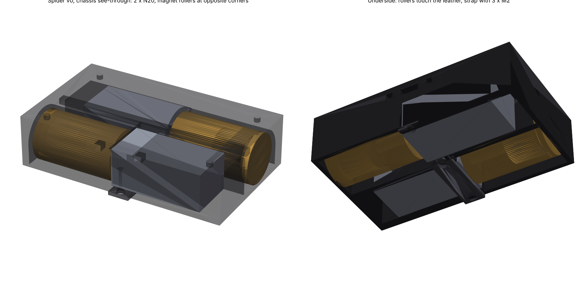
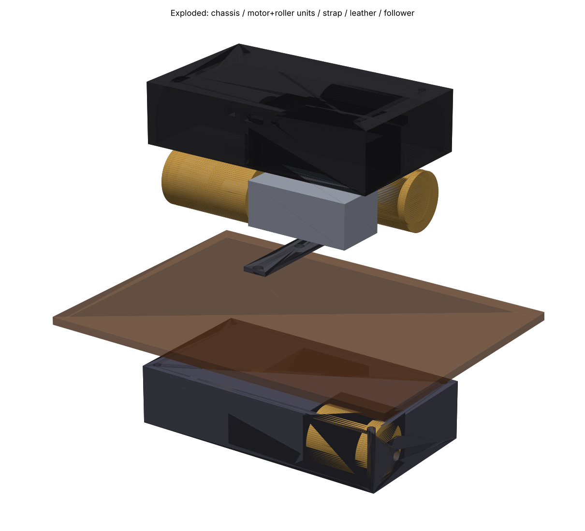

# Spider v0 (19 Nov 2026)

The first printable body for the vest spider bot. It continues Rovable v2 (`v2/` on the `v2` branch) with the
two changes Thomas decided on 19 Nov: his N42 10 x 4 mm disc magnets instead of the 8.92 x 25 mm rods, and no
electronics on the bot (the ESP32 and motor driver sit at the chest dock, wired through the tether).

**State: modelled and checked in code, not printed, not driven.** It exists to answer three questions on a
leather offcut tonight: does it go together, does it clamp, does it drive.

## Layout

- Two N20s lie side by side and point opposite ways. Each drives one roller: roller A at the +X end on one
  motor line, roller B at the -X end on the other. The two rollers steer it like a pair of wheels (Rovable v2 layout).
- Each roller is a printed tube holding **two stacked 10 x 4 discs** on the motor shaft. A disc magnetised
  through its thickness has a field that is symmetric about its axis, so the clamp stays steady as the roller turns.
  The 16 Nov test found the clamp force has to land on a wheel (`v2/evidence/README.md`), which is why the
  magnets are in the driven rollers.
- Under the leather, the follower carries two free rollers with two discs each, sitting under the driven magnets.
  **Fit them with the poles reversed** relative to the roller above: two magnets side by side attract when their
  poles point opposite ways. Check by hand before you glue anything: the follower roller should jump up to the
  bot's roller through the leather.
- Size: **54.5 x 32.3 x 15.4 mm** (Rovable v2 was 80 x 40 x 22). Flat top with 4 x M2 pilot holes for later.
  Tether leaves through the slot in the -Y side; two zip-tie slots beside it take the strain.
- Ground clearance: rollers touch the leather; the strap is 0.75 mm above it, the chassis 1.75 mm.

## Print (P1S, PLA, 0.2 mm, no supports)

| File | Copies | Orientation |
|---|---|---|
| `fit_coupon.stl` | 1 | as exported. **Print this first** (about 15 min) |
| `chassis.stl` | 1 | deck down, as exported |
| `strap.stl` | 1 | flat |
| `roller_x2.stl` | 2 | hub end down, as exported |
| `roller_cap_x2.stl` | 2 | flange down |
| `follower_frame.stl` | 1 | underside down |
| `follower_roller_x2.stl` | 2 | closed end down |
| `follower_cap_x2.stl` | 2 | flange down |

The fit coupon has four rings with 10.1, 10.2, 10.3 and 10.4 mm bores, a D hole and an N20 tunnel. The parts
use the 10.3 mm bore. If a disc drops through the 10.3 ring, or will not go in, tell Claude which ring is a firm
push fit and the bores change in one number (`BORE_R` in `cad/spider_v0.py`).

## Parts

| Part | Qty | Have it? |
|---|---|---|
| N20 gear motor, bare (no encoder board) | 2 | N20s were on hand for the 16 Nov rig. **Not in the 19 Nov inventory photos: confirm.** An N20 with an encoder board is about 9 mm longer and does not fit the tail pocket. Its encoder would also sit next to the other unit's roller magnet and read rubbish |
| N42 disc magnet 10 x 4 mm | 8 (4 on the bot, 4 in the follower) | yes, about 20 (not photographed) |
| M2 x 8 self-tapping screw | 3 (strap) | screws are always available |
| M3 x 8 screw | 4 (follower pivots) | as above |
| Tyre: 12-13 mm heat-shrink, or a stretched rubber band | 2 | check |
| Thin multi-core wire for the tether, 4 cores for v0 | 1-2 m | check |
| ESP32-S3-DevKitC-1 | 1 | yes (INV-002, sealed) |
| TB6612 dual motor driver (needs two header strips soldered) | 1 | yes (INV-014, sealed). L298N works too (INV-012, two) |
| Leather offcut, 1.5-2 mm | 1 | check |

## Build order (each step checked in code: nothing has to pass through anything)

1. Push two discs into each roller, through the open end, then press the cap's plug in. Put a drop of CA glue on
   the plug if it is loose.
2. Press each roller onto its motor's D shaft until it stops (the hole is 10 mm deep and the shaft 10 mm, so it
   bottoms 0.3 mm short of the gearbox face).
3. Solder about 10 cm of wire to each motor's terminals.
4. Turn the chassis upside down. Drop each motor-and-roller unit into its channel from below. The check
   `assembly_order` in `cad/checks.json` sweeps each unit down 40 mm and finds no collision.
5. Lay the strap across the gearbox ends and drive the three M2 screws in. The strap is what holds the motors
   in against the magnet pull, so do not skip it.
6. Run the wires up through the centre channel and out of the side slot, and zip-tie them through the two slots.
7. Follower: put two discs in each follower roller, **reversed**, and press in the caps. Set each roller in its
   well and drive an M3 screw through each end wall into the roller's end hole. It should spin freely.

## Tonight's test ladder

1. **T1 hold:** bot on top of the leather, follower underneath, rollers lined up. Turn the leather upside down
   and give it a shake. Does the bot stay on?
2. **T2 drag:** pull the bot sideways with a luggage scale or a phone on a string. At what pull does it slide?
3. **T3 drive flat:** run `firmware/spider_v0_drive` and drive forwards, backwards, and spin on the spot.
4. **T4 drive vertical:** hang the leather vertically and drive up. Then try upside down.

Write the numbers down, or say them in chat. They become the first entries in `v2/evidence/README.md`'s
list of things never measured.

## Firmware: `firmware/spider_v0_drive`

The ESP32-S3 makes its own WiFi network (`spider-v0`, password `spiderbot`). Open http://192.168.4.1 on your
phone and hold the arrows. The motors stop 0.4 s after you let go. You can also type `w`, `a`, `s`, `d` or
`x` in the Serial Monitor.

| ESP32-S3 | TB6612 | L298N |
|---|---|---|
| GPIO4 | AIN1 | IN1 |
| GPIO5 | AIN2 | IN2 |
| GPIO6 | PWMA | ENA (jumper off) |
| GPIO7 | BIN1 | IN3 |
| GPIO15 | BIN2 | IN4 |
| GPIO16 | PWMB | ENB (jumper off) |
| 3V3 | STBY, VCC | (none) |
| GND | GND | GND |
| (none) | VM: motor supply | 12V pin: 7-9 V |

Tie all the grounds together. Motor A is the +X roller. If "forward" makes it spin on the spot, flip
`A_REVERSED` or `B_REVERSED` at the top of the sketch.

## Known limits of v0 (on purpose)

- The rollers are cantilevered on the N20 shaft, with no outer bearing. That is fine for a test; v1 can add an
  end wall with an M3 pivot like Rovable v2 if the shaft deflects.
- No encoders, vibration motor or speaker yet; the dock, reel and angle turret come next.
- The follower is a chunky block, 60 x 32 x 13.5 mm. v1 slims it once T1 says how much clamp there is.
- Every fit marked ASSUMED in `cad/spider_v0.py` is unverified until the coupon is printed.
