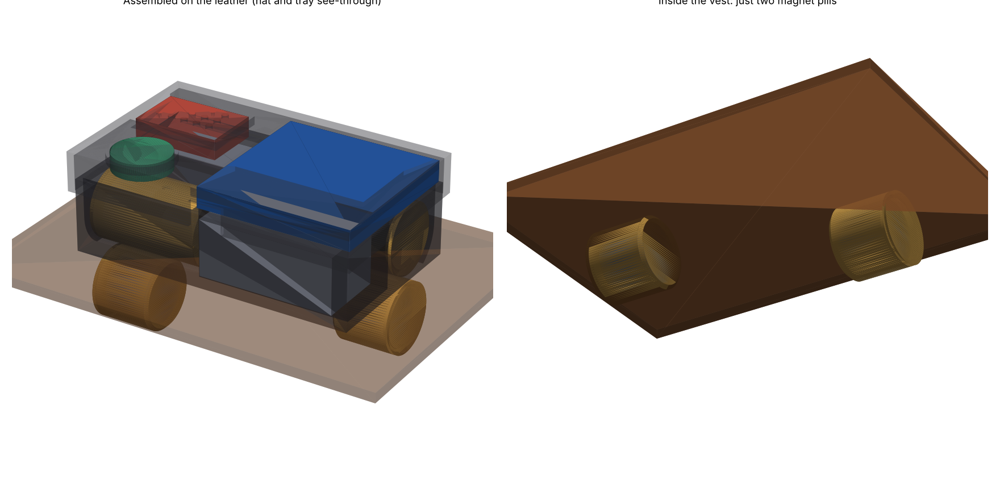
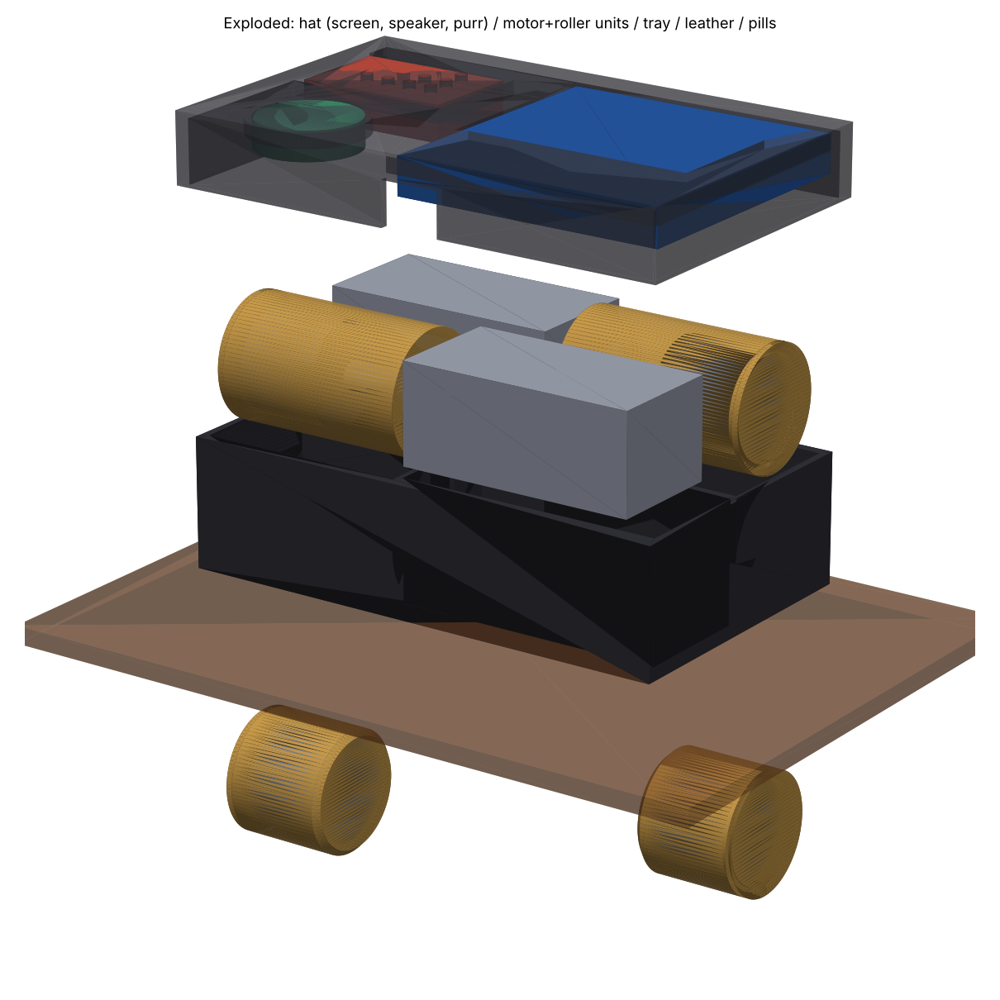

# Spider v1 (19 Nov 2026, 18:30)

Everything on top, only magnets underneath. Supersedes `spider-v0` (Thomas 18:14: the follower block was too
much; "bottom should just be the magnets").

**Size:** body 51.6 x 31.6 x 18.4 mm with the hat on (49.9 x 29.9 x 12.9 tray alone). Under the leather: two
pills, 12.3 mm across and 10.6 mm long. Two N20s side by side set the floor: this is within about 2 mm of the
smallest the motors allow. Going smaller needs smaller motors (the original Rovables used 6 mm gearmotors).

## How it works
- Each N20 drives a roller holding two 10 x 4 N42 discs. A pill with two discs sits under it, inside the vest.
  The two pull together through the leather, so the roller grips and the pill rolls along underneath.
  **Put the pill's discs in pointing the opposite way to the roller's**, then check by hand that the pill
  jumps to the roller through the leather.
- The tray: each motor-and-roller unit drops in from above onto a 0.8 mm floor. The magnet pull pushes the
  motors down into that floor, so no strap or screws are needed. A stop wall at each gearbox face keeps the
  motor from sliding toward its roller.
- The hat is a lid whose skirt slides 2 mm down over the outside of the tray. Under its top plate are pockets
  for a 0.96" I2C OLED (window over it), a 1510 micro speaker (grille over it) and a 10 mm coin vibration
  motor (the purr). The tether leaves through the notch at the -Y side.

## Checked in code (`cad/checks.json`)
All parts watertight and one solid. No clash between any two parts, printed or bought. Both units drop in from
above, bay parts press into the hat from below, and the hat drops onto the tray, all with no collision. There
is solid floor under both motors. Six faults were found and fixed by these checks while drawing it: shaft into
magnets, strap into rollers, lid overlap and no wire path (all v0), a closed bay nothing could get into, and
hat lips that blocked the OLED.

## Print (P1S, PLA, 0.2 mm, no supports): one plate per printer
| Plate | What | Time |
|---|---|---|
| 51 | fit coupon: 10.1 / 10.2 / 10.3 / 10.4 mm bores in 1.0 mm walls, D hole, N20 channel | see file name |
| 52 | tray | |
| 53 | hat | |
| 54 | 2 rollers + 2 lids | |
| 55 | 2 pills + 2 lids | |

The rollers and pills use the 10.3 bore. If the coupon says otherwise, only plates 54 and 55 need reprinting.

## Build
1. Two discs into each roller, then press the lid in (a drop of CA if it is loose). The same for each pill,
   with the discs reversed.
2. Press each roller onto its N20's D shaft until it stops.
3. Solder about 1 m of wire to each motor, flat along the tabs (the tail pocket is 3 mm).
4. Drop both units into the tray from above.
5. Hat: press in the OLED, speaker and coin motor (whatever you have now; the pockets hold them), lead the
   wires out of the notch, and push the hat on.

Wiring and the phone-drive firmware are the same as v0: `../spider-v0/firmware/spider_v0_drive`, README table.

## Bought parts
| Part | Qty | Status |
|---|---|---|
| N20 gearmotor, bare (no encoder) | 2 | Thomas has two (18:14) |
| N42 10 x 4 disc | 8 | about 20 on hand |
| 0.96" SSD1306 I2C OLED, 27.3 x 27.8 module | 1 | not in the inventory: buy or borrow |
| 1510 micro speaker (15 x 10 x 3.5) | 1 | not in the inventory (his 40-57 mm speakers do not fit) |
| 10 mm coin vibration motor | 1 | Anas has one: confirm its diameter |
| ESP32-S3 + TB6612 or L298N | 1 | INV-002, INV-014 / INV-012 |
